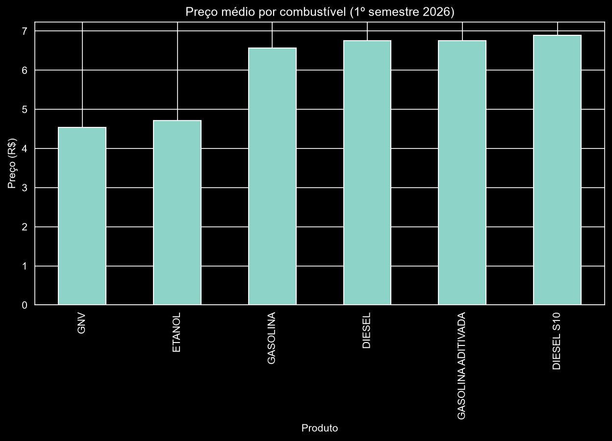
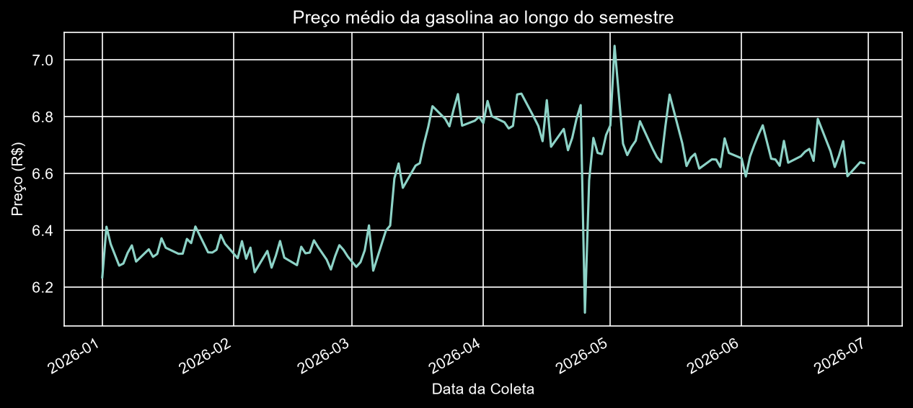

# Análise de Preços de Combustíveis no Brasil

Projeto de análise exploratória de dados públicos usando Python.

## Objetivo
Responder perguntas sobre a evolução e a variação dos preços de combustíveis no Brasil.

## Tecnologias
- Python 3.12
- Pandas
- Matplotlib
- Jupyter Notebook

## Fonte dos dados

Dados da ANP (série histórica de preços de combustíveis), 1º semestre de 2026.

- Download: https://www.gov.br/anp/pt-br/centrais-de-conteudo/dados-abertos/arquivos/shpc/dsas/ca/ca-2026-01.zip
- Crie a pasta `data` na raiz do projeto e salve o arquivo como `data/1_semestre_2026.csv` antes de rodar o notebook.

## Como rodar
1. Clone o repositório
2. Instale as dependências: `pip install -r requirements.txt`
3. Crie a pasta `data` e coloque o CSV dentro dela
4. Abra `notebooks/analise.ipynb`

## Resultados

### Preço médio por combustível

O diesel S10 foi o combustível mais caro na média (cerca de R$ 6,89) e o GNV o mais barato (cerca de R$ 4,54). O etanol (cerca de R$ 4,71) custou aproximadamente 72% do preço da gasolina (cerca de R$ 6,56), um pouco acima do limite de 70% usado como regra prática para saber se o etanol compensa.

### Preço da gasolina ao longo do semestre

O preço médio ficou estável em torno de R$ 6,30 em janeiro e fevereiro, subiu cerca de R$ 0,50 em março e se manteve mais alto até junho. O pico e a queda isolados no fim de abril provavelmente refletem poucas coletas naquelas datas, e não uma mudança real de preço.